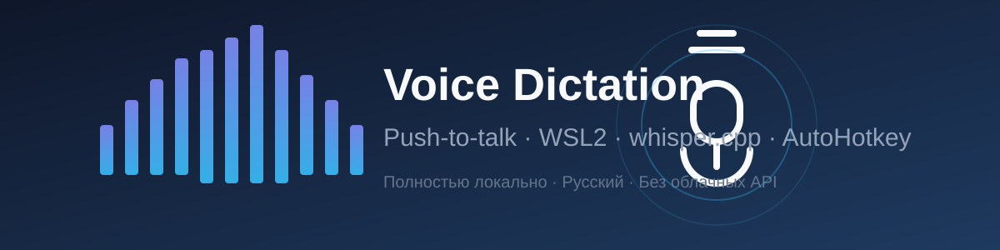

# 🎙️ Voice Dictation Stack



> Push-to-talk голосовая диктовка для Windows: зажал правый Alt → говоришь → отпустил → текст в активном окне.

**Полностью локально** — без облачных API, без интернета, приватно. Русская речь, whisper.cpp (ggml-small q5_1) на WSL2.

[](LICENSE)


## ✨ Возможности

- **Push-to-talk** — зажал клавишу, говори, отпустил — текст вставлен
- **Полностью офлайн** — распознавание локальное, ни байта в облако
- **Русский язык** — `-l ru`, качество слово в слово на длинных диктовках (43+ сек)
- **Автозапуск** — после перезагрузки Windows всё поднимается само
- **Самолечение** — AHK перезапускает упавший сервер без участия пользователя
- **Инструментирован** — все ошибки различимы (`ERR:curl/http/json/busy/gated_wav`), тайминги в лог
- **Фильтр галлюцинаций** — сны whisper приходят в `*звёздочках*`, ловятся универсальным правилом

## 🏗️ Архитектура

```
Windows (AutoHotkey v2)
  │  зажат/отпущен RAlt
  ▼
WSL2 Ubuntu
  ├─ dictate-record.sh   запись с RDPSource (mono 16k), RMS-пречек, гейт+нормализация
  ├─ whisper-server.sh   whisper.cpp server (ggml-small-q5_1, -t 8, без VAD, порт 8080)
  └─ результат: /tmp/dictate_out.txt + маркер /tmp/dictate_out.done
  ▲
  │  чтение по UNC (\\wsl.localhost\Ubuntu\tmp\...)
Windows (AHK): ждёт маркер (60с), вставляет текст через SendText
```

## Файлы

| Файл | Назначение |
|---|---|
| `dictate-record.sh` | main pipeline: stop-запись, RMS, гейт, curl к серверу, фильтры, маркер-вывод |
| `dictate-normalize.py` | нормализация (пик→0.95) + шумовой гейт (30мс фреймы, floor×1.8, min 60) |
| `whisper-server.sh` | wrapper сервера whisper.cpp (`-m q5_1 -l ru -t 8 -bs 1`) |
| `whisper-server.service` | systemd-юнит (multi-user, Restart=always) |
| `dictate.config` | конфиг: MODEL=q5_1 |
| `dictate.ahk` | AHK v2: хоткей RAlt, UNC-маркер, самолечение сервера, бипы |
| `dictate_autostart.bat` | автозапуск в реестре Windows (AHK + WSL-сервер) |
| `DICTATION_REPORT.md` | финальный отчёт о разработке и отладке |

## Установка (кратко)

1. WSL2 Ubuntu + PulseAudio (WSLg). Собрать whisper.cpp (`server`, `main`), модель q5_1 в `~/.local/share/dictate/models/`
2. Скопировать `*.sh` в `~/.local/bin/`, `dictate.config` → `~/.config/dictate/config`
3. `whisper-server.service` → `/etc/systemd/system/`, `systemctl enable --now whisper-server`
4. Windows: AutoHotkey v2, `dictate.ahk` в `C:\Users\<user>\`, автозапуск через `dictate_autostart.bat`
5. Устройство ввода Windows: микрофон-гнездо (например, BOYA BY-M1 Pro II), 100%, эффекты выключить

## Принципы (добыто кровью)

- **Без VAD**: Silero-гейт режет тихую речь; `no_speech_prob` галлюцинации не гасит
- **Галлюцинации whisper** приходят в `*звёздочках*` → универсальный фильтр, чёрный список — второй слой
- **Маркер `.done`** вместо гонки чтения файла (AHK читает только по маркеру)
- **Гейт-first**: первый проход — нормализация+гейт, ретрай при пустом — сырой файл
- **Инструментация**: `ERR:curl(rc)`, `ERR:http(code)`, `ERR:json`, `ERR:busy`, `ERR:gated_wav`, `SILENCE`
- **Самолечение**: AHK при ошибках сервера → `wsl -u root systemctl restart whisper-server`
- **Тайминги**: лог в `~/.local/share/dictate/dictate_timing.log` (переживает перезагрузки)

## Лимиты

- Комфортная диктовка: ~45-50 сек (AHK-дедлайн 60с = запись + 0.25-0.3×обработка)
- Жёсткий потолок: ~70-80 сек (curl -m 25)
- Длиннее — диктуй частями, отпуская Alt

## 📋 Логи

| Лог | Путь |
|---|---|
| Тайминги/гейт/ошибки | `~/.local/share/dictate/dictate_timing.log` |
| AHK | `C:\Users\<user>\dictate.log` |
| Сервер | `journalctl -u whisper-server` |

## 📜 Лицензия

MIT — используй, форкай, делись. Поставь ⭐ если пригодилось!

---

*Собрано за один день разработки и отладки на реальной диктовке. Подробности: [DICTATION_REPORT.md](DICTATION_REPORT.md).*